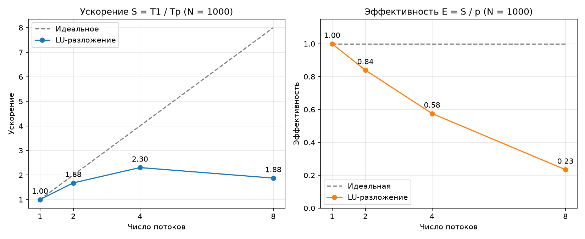

# Семинар 6. LU-разложение (OpenMP)

## Сборка и запуск (из папки `parall_prog`)

```bash
brew install libomp   # один раз
clang++ -O2 -Xpreprocessor -fopenmp -I/opt/homebrew/opt/libomp/include \
    -L/opt/homebrew/opt/libomp/lib -lomp seminar_06/lu.cpp -o seminar_06/lu
./seminar_06/lu > seminar_06/output.txt
python3 seminar_06/plot.py   # нужен matplotlib
```

## Алгоритм

A = L·U, у L единичная диагональ (схема Дулиттла), разложение без перестановок строк.

1. **L по матрице A** (`compute_L`): прямой ход Гаусса на копии A, множители
   l_ik = a_ik / a_kk записываются в L. На шаге k строки i > k обновляются
   независимо, поэтому цикл по i распараллелен через `omp for`. Параллельная
   область создаётся один раз на все шаги k, синхронизация — неявный барьер.
2. **U по матрицам A и L** (`compute_U`): u_ij = a_ij − Σ_{k<i} l_ik·u_kj.
   Столбцы U не зависят друг от друга (каждый — прямая подстановка
   L·U[:,j] = A[:,j]), поэтому параллелизм идёт по блокам из 64 столбцов
   без барьеров.
3. **Решение**: L·y = b (прямая подстановка), U·x = y (обратная), O(n²).

Проверка: L·U сравнивается с A (max|L·U − A|), решение — по невязке max|A·x − b|.

## Результаты для систем а)–к)

| | Решение | max\|L·U − A\| |
|---|---|---|
| а | (2; 3) | 0 |
| б | (−1; 2) | 0 |
| в | (1; −1) | 0 |
| г | (2; −1; 1) | 0 |
| д | (4; 5; −3) | 0 |
| е | (0; 3; −3) | 0 |
| ж | (2; 1; 0) | 0 |
| з | (1; 0; −1) | 0 |
| и | (−1; 0; 2) | 0 |
| к | (1; −1; 2) | 0 |

Матрицы A, L, U и L·U для каждой системы приведены в `output.txt`.

## N = 1000 (случайные коэффициенты, диагональное преобладание)

Apple M4 (4 производительных + 6 энергоэффективных ядер), лучшее из 3 запусков:

| Потоки | Время, с | Ускорение | Эффективность |
|---|---|---|---|
| 1 | 0.0792 | 1.00 | 1.00 |
| 2 | 0.0468 | 1.69 | 0.85 |
| 4 | 0.0350 | 2.26 | 0.57 |
| 8 | 0.0422 | 1.88 | 0.23 |

max|L·U − A| = 2.1e−11, max|A·x − b| = 7.6e−13.



**Выводы.** Ускорение растёт до 4 потоков, на 8 потоках падает:
- в `compute_L` n = 1000 последовательных шагов с барьером, а работа на шаге k
  уменьшается как (n−k)²; на последних шагах накладные расходы синхронизации
  больше полезной работы;
- задача целиком занимает ~80 мс, поэтому доля накладных расходов велика;
- у M4 только 4 производительных ядра, при 8 потоках часть работы уходит на
  медленные энергоэффективные ядра, и быстрые потоки ждут их на барьерах;
- прямой и обратный ход (O(n²)) выполняются последовательно (закон Амдала).
