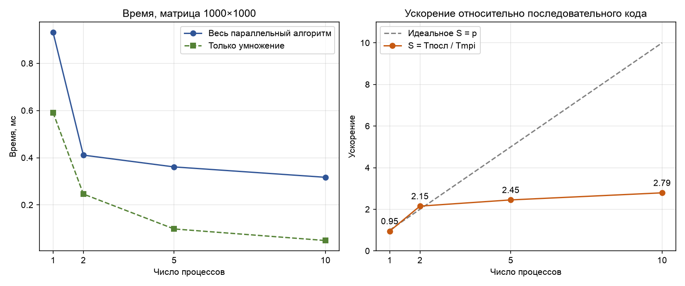

# Семинар 8. Умножение матрицы на вектор (MPI)

Матрица 1000×1000, вектор из 1000 элементов. Запуски на 1, 2, 5 и 10 процессах.
Элементы те же, что в семинаре 3: A[i,j] = 1 + (i+j) mod 7, b[j] = 1.

## Сборка и запуск (из папки `parall_prog`)

Нужен OpenMPI (`brew install open-mpi`). На macOS у `mpirun` короткий каталог для временных файлов, поэтому задан `TMPDIR`.

```bash
mpicxx -std=c++17 -O2 seminar_08/matvec_mpi.cpp -o seminar_08/matvec
export TMPDIR=/tmp
printf 'processes,time_parallel,scatter,bcast,compute,gather,time_sequential,speedup,max_diff\n' \
    > results/seminar8_matvec.csv
for p in 1 2 5 10; do mpirun -n $p ./seminar_08/matvec; done
python3 seminar_08/plot.py
```

Программа дописывает строку в csv. Перед новой серией файл нужно обнулить командой `printf` выше.
`plot.py` оставляет лучший запуск по каждому числу процессов и строит графики.

## Как устроена программа

Матрица целиком собирается на процессе 0. Один процесс не умножает её сам: строки делятся поровну, у каждого процесса свой кусок результата.

1. `MPI_Scatter` отдаёт каждому процессу `1000 / p` строк. На 2 процесса это 500 строк, на 5 — 200, на 10 — 100. 1000 делится на все три числа, остатка нет.
2. `MPI_Bcast` рассылает вектор b. Он нужен целиком: элемент c[i] зависит от всех b[j], а не от куска.
3. Процесс считает только свои строки: c[i] = Σ_j A[i,j] · b[j]. Чужие строки ему не нужны.
4. `MPI_Gather` собирает куски c обратно на процесс 0.

Процесс 0 отдельно прогоняет тот же подсчёт без MPI. Ускорение S = Tпосл / Tmpi. Расхождение `max|c_mpi − c_seq|` равно 0, контрольная сумма 4000002.

Программа печатает начало вектора c и записывает все 1000 элементов в `solution.txt` тремя столбцами: MPI, последовательный счёт и значение по формуле. Формула получается из-за b[j] = 1 и периода 7 у элементов матрицы: в строке 142 полных цикла остатков 0..6 (вклад 3976) и ещё 6 элементов, поэтому c[i] зависит только от i mod 7:

| i mod 7 | 0 | 1 | 2 | 3 | 4 | 5 | 6 |
|---|---|---|---|---|---|---|---|
| c[i] | 3997 | 4003 | 4002 | 4001 | 4000 | 3999 | 3998 |

Время одной операции — доли миллисекунды, поэтому берётся лучший из 20 повторов (первый проход — прогрев и в замер не входит).

## Результаты

Apple M4, OpenMPI 5, `mpicxx -O2`. Tпосл = 0.789 мс — одно и то же значение для всех строк.

| Процессы | Всё вместе, мс | Scatter | Умножение | Gather | Ускорение |
|---|---|---|---|---|---|
| 1 | 0.576 | 0.143 | 0.433 | 0 | 1.37 |
| 2 | 0.372 | 0.152 | 0.219 | 0 | 2.12 |
| 5 | 0.365 | 0.201 | 0.117 | 0.042 | 2.16 |
| 10 | 0.312 | 0.219 | 0.050 | 0.039 | 2.53 |



Таблица и графики: `results/seminar8_matvec.xlsx`.

**Выводы.** Само умножение ускоряется почти линейно: 0.433 → 0.219 → 0.117 → 0.050 мс. Общее время — нет. `MPI_Scatter` раздаёт те же 8 МБ матрицы, и с ростом числа процессов эта раздача не дешевеет (0.14 → 0.22 мс). На 10 процессах пересылка уже дольше счёта. Поэтому ускорение всего алгоритма останавливается около 2.5 вместо идеальных 10: для матрицы 1000×1000 работа слишком короткая, чтобы окупить обмен.
