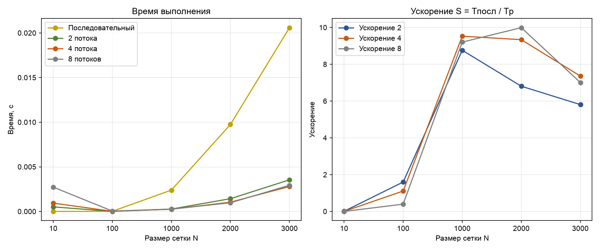

# Семинар 9. Уравнение Пуассона, метод Гаусса–Зейделя (OpenMP)

На единичном квадрате решается

u_xx + u_yy = f(x, y) = 1, на границе u = 0.

Сетка с шагом h = 1/(N+1): внутри N×N узлов, граница нулевая. Останов — max|u_new − u_old| < 0.0001.
Размеры из задания: 10, 100, 1000, 2000, 3000. Потоки: 2, 4, 8.

## Сборка и запуск (из папки `parall_prog`)

```bash
clang++ -std=c++17 -O2 -Xpreprocessor -fopenmp \
    -I/opt/homebrew/opt/libomp/include -L/opt/homebrew/opt/libomp/lib -lomp \
    seminar_09/gauss_seidel.cpp -o seminar_09/gauss_seidel
./seminar_09/gauss_seidel
python3 seminar_09/plot.py
```

## Как устроена программа

Пятиточечная схема превращается в одно правило. Новое значение в узле — среднее соседей с поправкой на правую часть:

u[i,j] = (u[i−1,j] + u[i+1,j] + u[i,j−1] + u[i,j+1] − h²) / 4

В методе Гаусса–Зейделя это значение сразу записывается в сетку. Следующий узел уже видит новых соседей слева и сверху. Из-за этого обычный двойной цикл нельзя разрезать между потоками: поток, взявший строку i, читает строку i−1, которую другой поток может писать в этот же момент.

Параллельная версия — красно-чёрный обход. Узлы красятся как доска: цвет клетки (i+j) чётное или нечётное. Сосед любой клетки всегда другого цвета, поэтому все красные узлы не зависят друг от друга. Сначала OpenMP обновляет все красные (`omp for` и неявный барьер), потом все чёрные. Это по-прежнему Гаусс–Зейдель, только порядок узлов другой.

Последовательная версия идёт по строкам, слева направо. На N = 10 после 400 итераций обе сетки совпадают: max|разность| = 5.6·10⁻¹⁷, u_min ≈ −0.072. Точное решение этой задачи по модулю около 0.074, то есть маленькая сетка действительно считается.

## Результаты

Apple M4 (4 производительных + 6 энергоэффективных ядер), clang -O2, лучшее из 5 запусков.
Ускорение S = Tпосл / Tпараллельный.

| N | Последовательный, с | 2 потока, с | S | 4 потока, с | S | 8 потоков, с | S |
|---|---|---|---|---|---|---|---|
| 10 | 0.000009 | 0.000754 | 0.012 | 0.001212 | 0.007 | 0.004482 | 0.002 |
| 100 | 0.000021 | 0.000015 | 1.40 | 0.000018 | 1.16 | 0.000092 | 0.23 |
| 1000 | 0.002534 | 0.000301 | 8.41 | 0.000247 | 10.26 | 0.000265 | 9.57 |
| 2000 | 0.009843 | 0.001398 | 7.04 | 0.000965 | 10.20 | 0.000901 | 10.92 |
| 3000 | 0.020872 | 0.003384 | 6.17 | 0.002686 | 7.77 | 0.002551 | 8.18 |



Таблица в том же виде, что в примере к заданию, и оба графика: `results/seminar9_gs.xlsx`.

Итерации до остановки:

| N | Последовательный | Красно-чёрный |
|---|---|---|
| 10 | 53 | 52 |
| 100 | 1 | 1 |
| 1000 | 1 | 1 |
| 2000 | 1 | 1 |
| 3000 | 1 | 1 |

**Почему на больших сетках одна итерация.** Первая поправка к нулевой сетке имеет величину порядка h². При N = 100 это уже 5·10⁻⁵, то есть меньше eps = 10⁻⁴, и цикл останавливается. Значение u при этом почти нулевое, уравнение ещё не решено. На N = 10 h² больше порога, выполняется 53 итерации и получается u_min = −0.071. Время на N ≥ 100 — это время одного прохода по сетке, оно растёт как N². Так же выглядит пример из задания.

**Почему ускорение больше числа потоков.** В последовательном обходе каждый узел ждёт соседа слева, компилятор не может считать ячейку строки независимо. В красно-чёрном обходе узлы одного цвета независимы. Уже один поток красно-чёрной схемы на N = 3000 быстрее последовательной в 3.6 раза (0.00580 с против 0.0209 с). Дальше OpenMP даёт ещё примерно 2.2 раза на 4 потоках и 2.3 раза на 8: сетка 3000×3000 — это 72 МБ, скорость упирается в память, а быстрых ядер у M4 четыре. На N = 10 полезной работы меньше, чем стоит запуск потоков, ускорение много меньше единицы.
